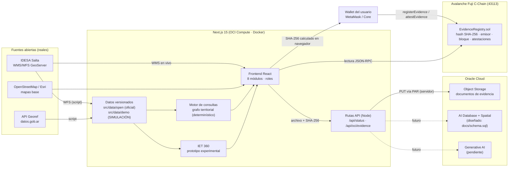

# Arquitectura — TERRITORIO 360

## Flujo de evidencia verificable

1. **Registro**: el responsable (rol Empresa) elige el compromiso y adjunta el archivo.
2. **Huella**: el navegador calcula SHA-256 con Web Crypto. El archivo no sale del equipo salvo que se elija OCI.
3. **Almacenamiento (opcional)**: `/api/oci/evidence` recalcula el SHA-256 en el servidor, rechaza si no coincide y guarda el objeto en OCI con metadato `opc-meta-sha256`. La PAR vive solo en el servidor.
4. **Anclaje**: la wallet firma `registerEvidence(projectId, commitmentId, sha256, offchainRef)` en Fuji. Se muestra tx hash, estado (pendiente/confirmada/fallida), bloque y link a Snowtrace.
5. **Verificación**: cualquiera recalcula el hash de un archivo y lo compara con el contrato (lectura pública por RPC).
6. **Atestación**: un verificador habilitado por el owner, distinto del emisor, firma `attestEvidence(hash, Contrasted|Rejected)`.

Niveles de evidencia: **Declarado** (sin documento) → **Documentado** (documento con huella anclada o almacenada) → **Contrastado** (con fuente independiente) → **Verificado por terceros** (atestación on-chain de un verificador distinto del emisor).

## Qué va on-chain y qué no

| On-chain (público) | Off-chain |
|---|---|
| `keccak256(projectId)`, `keccak256(commitmentId)`, SHA-256 del archivo, emisor, timestamp, bloque, referencia corta (≤ 200 bytes), atestaciones | El documento, datos personales, expedientes, observaciones comunitarias |
